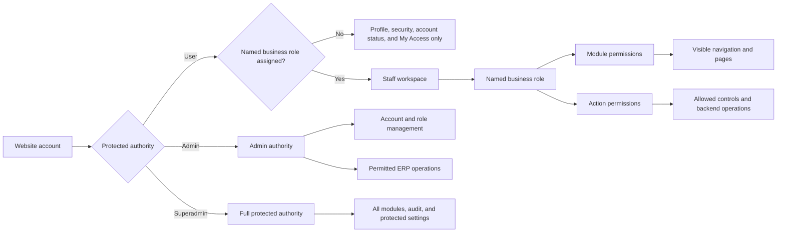
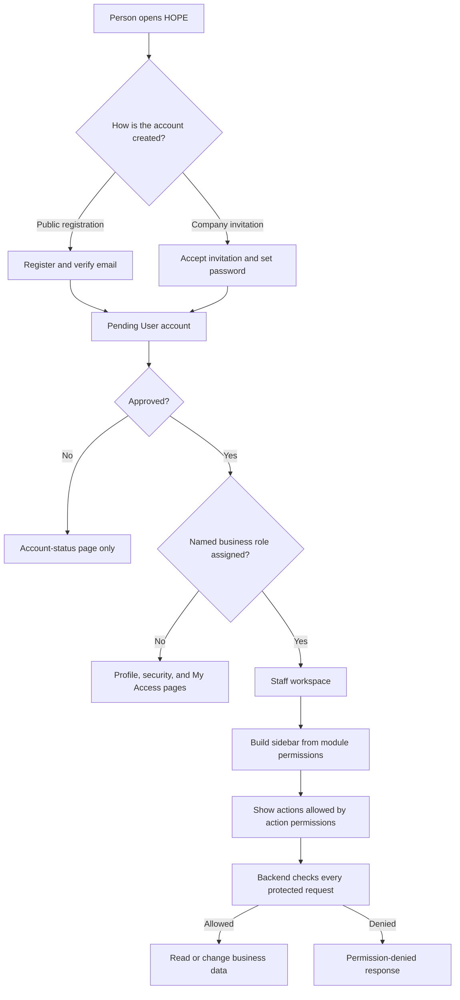
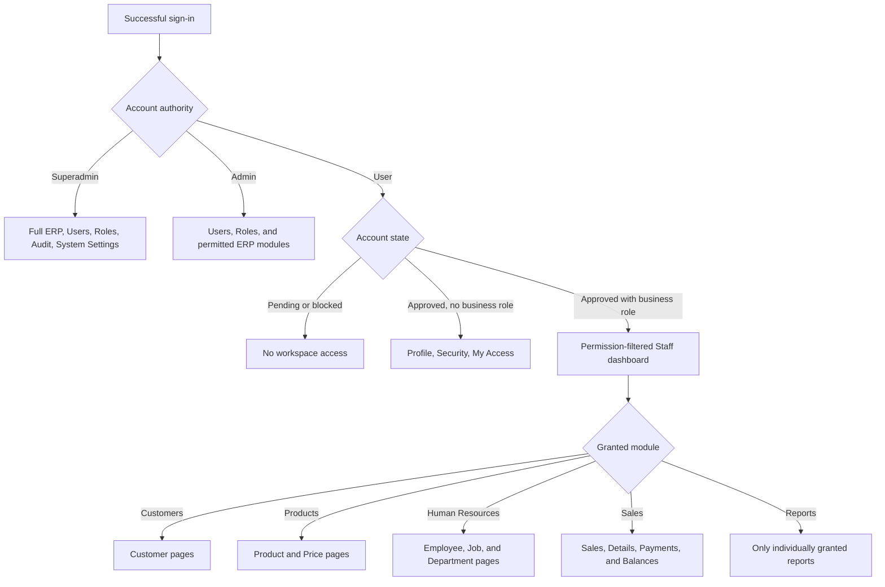

# HOPE Account, Staff Role, and Workspace Plan

## Status

Draft for professor and team confirmation. This document defines the recommended direction; it does not authorize database or application changes by itself.

## Problem

The current requirements and implementation use three protected account roles: `superadmin`, `admin`, and `user`. The earlier project guide described an ordinary User as Staff, but the professor has clarified that a User is not automatically a Staff member.

This creates two product questions:

1. What can a registered User do if the account has no business role?
2. Which ERP pages should appear for Staff, Admin, and other account types?

Adding marketplace features only to give User accounts something to do would change HOPE from an internal ERP into a vendor or seller platform. Product ownership, vendor approval, inventory, commissions, payouts, and seller analytics are not part of the current requirements or schema. They must not be added without an explicit professor-approved requirement.

## Recommended model

Separate identity, authority, and job responsibility:

```text
Account
  -> protected account authority: User, Admin, or Superadmin
  -> optional named business role: Sales Staff, HR Staff, Product Staff, etc.
  -> effective permissions: module and action rights supplied by that named role
```

In this model:

- **User** means a standard authenticated account. It is not a job title.
- **Staff** means a standard User account assigned an active named business role with ERP permissions.
- **Admin** is a protected authority that manages permitted accounts, roles, and operations.
- **Superadmin** is the protected system-owner authority with full access.
- Every Staff member is a User account, but not every User account is Staff.

The existing `permission_role` design already supports named roles and checkbox-based rights. Preserve it rather than introducing a second competing role system.

### Account, role, and permission relationship



The diagram shows why User should not be treated as a job title. User identifies the base account authority; the named business role and its permissions determine whether the account receives a Staff workspace.

## Role and permission behavior

### Protected account authorities

These remain system-controlled and cannot be recreated as ordinary named roles:

| Authority | Purpose |
| --- | --- |
| User | Base account with no automatic ERP authority |
| Admin | Account, role, and permitted operational management |
| Superadmin | Full protected authority, including Admin designation and system oversight |

### Named business roles

Admins or Superadmins can create roles using the existing Discord-style permission editor. Suggested roles include:

- Sales Staff
- HR Staff
- Product Staff
- Accounting Staff
- Sales Manager
- Report Viewer

Each named role contains checked module and action permissions. Examples:

```text
Sales Staff
  [x] View Customers
  [x] Add Customers
  [x] View Products
  [x] View Sales
  [x] Create Sales
  [ ] Edit Product Prices
  [ ] View Employee Job History
  [ ] Manage Users
```

An account without a named business role has no operational ERP permissions unless the authorized design deliberately assigns individual custom permissions.

### Multiple roles

The current implementation assigns one `permission_role` or a custom per-user permission set. Keep this single-role model for the first release unless the professor explicitly requires multiple simultaneous roles.

If multiple roles are later approved, define effective permissions as the union of all active assigned roles and add conflict, deactivation, audit, and migration rules before implementation.

## Page and navigation model

### Public pages

- Landing page
- Registration, if public registration remains required
- Email verification
- Login
- Forgot password and password reset

Public pages do not expose business records.

### Pending or unapproved User

- Account status
- Email verification or resend flow
- Sign out
- Help or contact information

The page should clearly explain that verification does not grant business access and that the account is awaiting approval.

### Approved User without a named business role

- My Profile
- Security and password controls
- My Access: read-only account authority, assigned role, and effective permissions
- Request Access or administrator contact instructions, if the team approves this workflow
- Sign out

Do not show an empty operational dashboard or fake business statistics. Use a clear state such as:

> Your account is active, but no business role has been assigned. Contact an administrator to request access.

### Staff User with a named business role

Show only pages allowed by effective permissions. Examples:

| Named role | Typical pages |
| --- | --- |
| Sales Staff | Dashboard, Customers, Products, Sales, Payments |
| HR Staff | Dashboard, Employees, Jobs, Departments, permitted job history |
| Product Staff | Dashboard, Products, Price History |
| Accounting Staff | Dashboard, Payments, Balances, permitted Reports |
| Report Viewer | Dashboard and individually permitted Reports |

The sidebar, quick actions, dashboard counts, page controls, and backend routes must use the same effective permission source.

### Admin

- Account approval and account status management within the approved hierarchy
- Users
- Named Roles and permission editor
- Permitted business modules
- Active, inactive, and all-record views where authorized

Admin must not gain Superadmin authority through a named role or checked business permission.

### Superadmin

- All Admin and operational pages
- Admin designation and protected account management
- Audit log
- Protected system settings
- Last-Superadmin safeguards

## Account lifecycle

If public registration remains required:

```text
Register
  -> verify email
  -> pending User account
  -> Superadmin approval under the current hierarchy
  -> assign a named business role or custom permissions
  -> role-filtered workspace becomes available
```

An alternative for a private company ERP is invitation-only staff onboarding:

```text
Admin creates or invites account
  -> authorized manager assigns named business role
  -> person verifies email and sets password
  -> approved role-filtered workspace becomes available
```

Do not replace the existing registration flow until the professor chooses between public registration and invitation-only onboarding.

### Registration and workspace decision flow



### Page-selection flow after sign-in



## Permission and data-scope boundary

Permissions answer **what action** an account may perform. They do not automatically answer **which records** the account may access.

The current ERP primarily uses module/action permissions and active-record restrictions. If the professor later requires rules such as "view only my sales," "view only my department," or "view all records," add an explicit data-scope design such as `own`, `department`, or `all`. Do not infer row ownership from frontend filters.

All permission and scope rules must be enforced by the backend. Hiding a page or button is only a presentation behavior.

## Marketplace and external-user proposal

Do not let ordinary Users add their own products under the current scope.

That workflow would require an explicitly defined external role such as Vendor and new requirements for:

- Vendor/company ownership
- Vendor staff accounts
- Vendor-owned products
- Product review and approval
- Inventory responsibility
- Order allocation
- Fees or commissions
- Payouts
- Vendor-specific sales and performance reports
- Row-level isolation between vendors

If the professor wants this direction, treat it as a separate marketplace or vendor-portal feature proposal, not as an interpretation of the existing User role.

## Implementation phases after approval

### Phase 1: Confirm terminology and workflow

- Ask the professor whether User means the base account or a specific external actor.
- Ask whether registration is public or invitation-only.
- Confirm whether one named role per account is sufficient.
- Confirm who can create, edit, deactivate, assign, and remove named roles.
- Record the answers in the authoritative requirements documentation.

### Phase 2: Align interface language

- Keep Users as the account-management page.
- Label `permission_role` in the UI as Assigned role or Business role.
- Remove wording that treats User as a staff job title.
- Add the Account Status and My Access states.
- Add a clear no-role workspace instead of an empty dashboard.
- Ensure role names and descriptions explain their business purpose.

### Phase 3: Align backend contracts

- Preserve the protected `user/admin/superadmin` authority boundary.
- Verify that a base User receives no operational access by default.
- Verify that named-role changes affect the next protected request.
- Verify that inactive roles remove their granted access according to the approved policy.
- Keep audit records for role creation, permission changes, assignment, removal, and deactivation.
- Prevent named roles from granting protected Admin or Superadmin authority.

### Phase 4: Page authorization and navigation

- Generate navigation, quick actions, and dashboard contents from effective permissions.
- Provide a friendly permission-denied page for direct unauthorized URLs.
- Keep profile/security pages separate from protected System Settings.
- Verify that every visible action has a matching server authorization check.

### Phase 5: Testing

Test at minimum:

1. Pending User cannot sign in or open business modules.
2. Approved User without a named role sees only account pages and the no-role message.
3. Staff User sees only the modules and actions granted by the assigned named role.
4. Changing a role updates existing members on their next protected request.
5. Deactivating a role removes its operational access without deleting the accounts.
6. Admin cannot see or modify protected Superadmin accounts.
7. A named role cannot grant Admin or Superadmin authority.
8. Direct API and URL access is denied when the corresponding permission is absent.
9. Audit entries identify the actor, target account or role, change, and time.
10. Desktop and mobile navigation correctly handle no-role, Staff, Admin, and Superadmin states.

## Acceptance criteria

This plan is ready for implementation only when:

- The professor has defined whether User is a base account or a concrete external actor.
- Every approved actor has at least one real task and corresponding page or state.
- No marketplace behavior is assumed without approval.
- Staff access comes from named business roles and effective permissions.
- Base Users do not receive operational ERP access by default.
- Page visibility and backend authorization use the same permission contract.
- Protected Admin and Superadmin authority cannot be created through custom roles.
- Registration, approval, role assignment, blocked status, and no-role behavior are documented end to end.

## Questions for professor confirmation

1. Is User only the base website account, or does User represent a specific external person such as a customer or vendor?
2. If User is external, what exact task must they complete and which records belong to them?
3. Should staff register themselves, or should an Admin invite them?
4. Can one account have multiple named business roles, or exactly one?
5. Who may create and assign named roles: Admin, Superadmin, or both?
6. Should Staff see all permitted module records, only their department's records, or only records assigned to them?
