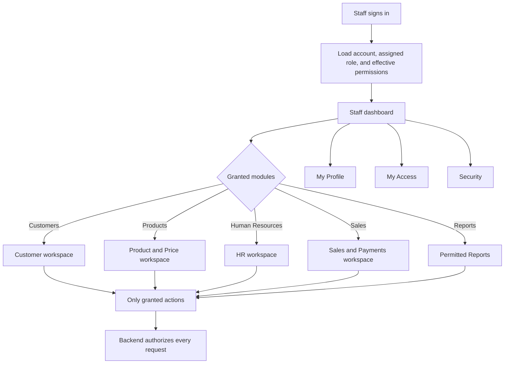
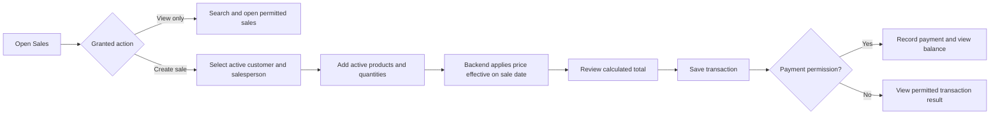

# HOPE Staff Workspace UI Plan

## Status

Draft for team and professor review. This plan builds on `account-role-and-workspace-plan.md` and assumes that Staff means an approved User account with an assigned named business role and effective ERP permissions.

## Goal

Give Staff a focused internal workspace for completing permitted business tasks without exposing Admin-only account management, protected settings, inactive records, audit details, or unrelated modules.

The Staff UI is not a customer shop, seller portal, or marketplace. It is the operational side of the HOPE ERP for company personnel.

## Core design decision

Do not create a completely separate copy of every page for Staff.

Use one shared ERP workspace and adapt it from the authenticated account's effective permissions:

```text
Shared workspace shell
  -> Staff sees permitted operational pages and actions
  -> Admin sees permitted operational pages plus administration
  -> Superadmin sees all operational and protected pages
```

This reduces duplicated frontend code and prevents Staff and Admin screens from drifting apart. The visible navigation, dashboard content, table columns, record actions, and API authorization must all use the same effective permission contract.

The existing frontend is stored under `frontend/admin/`, but ordinary permission-filtered Users already reuse much of it. A later implementation may move the shared shell to a neutral `frontend/workspace/` path. Do not perform that structural move until routing, imports, browser tests, and deployment behavior are inventoried and a safe migration is approved.

## Staff workspace map



## Shared application shell

Every Staff page should use the same shell.

### Sidebar

Show:

- HOPE, Inc. brand
- Dashboard
- Only modules whose view gate is granted
- Reports only when at least one report is granted
- Profile/account entry
- Sign out

Do not show:

- User Management
- Roles and permission editor
- Audit Log
- Protected System Settings
- Modules without their view permission

The sidebar must support expanded, collapsed, and mobile-drawer states. The active page must be identified visually and with `aria-current="page"`.

### Top bar

Include:

- Page title and short task-oriented description
- Mobile navigation button
- Contextual primary action only when granted, such as Add Customer or New Sale
- Optional page-local search when the current page supports it
- Profile menu

Avoid global controls that appear usable but only work for Admins.

### Profile menu

Include:

- Staff member's display name
- Assigned business role
- My Profile
- My Access
- Security
- Sign out

Do not label this menu Administrator for ordinary Staff.

## Dashboard

The Staff dashboard should answer:

1. What work can I access?
2. What needs my attention?
3. What can I do next?

It should not display every company metric by default. Cards and summaries must be based on granted modules and safe data.

### Dashboard structure

```text
+--------------------------------------------------------------+
| Good morning, [Name]                    [Profile] [Sign out]  |
| [Assigned role]                                             |
+----------------+---------------------------------------------+
| Sidebar        | Quick actions                               |
|                | [Add customer] [New sale] [Record payment]  |
| Dashboard      | Only actions the account may perform        |
| Customers      +---------------------------------------------+
| Products       | Work summary                                |
| Sales          | Permission-safe module cards and counts     |
| Reports        +---------------------------------------------+
|                | Recent accessible records                   |
| My Profile     | Records from granted modules only           |
+----------------+---------------------------------------------+
```

### Dashboard content rules

- Show a module card only when its view gate is granted.
- Show a quick action only when its action permission is granted.
- Do not show HR totals without HR view permission.
- Do not show sales or payment amounts without the relevant Sales access.
- Do not show inactive-record counts, audit stamps, or administrative totals to Staff.
- Recent records must be limited to modules the account may view.
- Empty access should lead to the My Access/no-role state, not an empty dashboard.
- Dashboard data must come from live permission-filtered endpoints, not hard-coded examples.

### Suggested permission-aware cards

| Granted access | Possible dashboard card |
| --- | --- |
| Customers view | Active customers |
| Products view | Active products and products without a current price, if safe |
| HR view | Active employees, subject to privacy rules |
| Sales view | Accessible sales transactions |
| Payments view | Accessible payment total or outstanding balances |
| Reports view | Shortcut to the granted report list |

Exact metrics require backend contract confirmation. A card should be omitted when its data cannot be returned safely.

## Operational module pages

### Customers

Purpose: find and maintain the people or organizations to whom HOPE sells.

Staff view:

- Active customer list
- Search, sorting, grouping, and approved filters
- Customer detail
- Address and payment terms
- Add, Edit, and Make Inactive only when individually granted

Restrictions:

- No inactive/all tabs for ordinary Staff unless a new explicit permission is approved
- No `is_deleted`, Status, Stamp, or audit metadata
- No Restore control
- Direct API access must enforce the same action permissions

### Products and price history

Purpose: view the product catalog and, for authorized Staff, maintain products and prices.

Staff view:

- Active product list
- Current price
- Product detail
- Price-history tab when product view is granted
- Add/Edit Product and Add/Edit/Delete Price only when granted

Restrictions:

- Do not expose inactive products or deleted price rows
- Product Staff can manage HOPE products; they do not own products as outside sellers
- System-generated identifiers and audit fields remain read-only or hidden

### Human Resources

Purpose: manage the organization's employee, job, department, and job-history records.

Staff view depends on separate rights:

- Employees
- Jobs
- Departments
- Job History

Privacy rules:

- Job-history and salary information require the specific Job History view permission
- Birth dates, salaries, and other personal data must not appear in general dashboard or search results without a requirement
- Add/Edit/Archive actions appear only when granted
- Firing or separation remains a high-risk workflow with explicit confirmation and the current authority boundary

### Sales and payments

Purpose: create and manage transactions, line items, payments, and balances.

Staff view:

- Sales list
- Sale detail
- Customer and salesperson references
- Line items
- Payments and balances
- New Sale, Edit Sale, Add/Edit/Delete Detail, and Record Payment only when granted

Workflow:



Restrictions:

- Transaction numbers are generated and read-only
- Product prices and totals are authoritative backend calculations
- Staff cannot reference inactive or missing customers, employees, or products
- Delete/restore and inactive-record visibility follow the approved permission and authority rules

### Reports

Purpose: provide read-only business results.

Staff should see only individually granted reports:

- Top Customers
- Product Master List
- Top Products
- Active Employees
- All Employees
- Employee Job History
- Top Sales

Each permitted report may provide its required date range, Top N, employee selector, Print, and Save as PDF controls. Do not show disabled tabs for reports the Staff member cannot access; omit them and handle direct URLs with a clear permission-denied state.

## Account pages

### My Profile

Include only fields the account owner is allowed to maintain, such as display name and approved contact information. Email, username, linked sign-in method, and employee linkage require explicit backend rules before becoming editable.

### My Access

Read-only explanation of:

- Account status
- Protected account authority, expressed in user-friendly language
- Assigned business role
- Role description
- Effective module and action permissions
- Administrator contact or access-request guidance

Do not expose internal permission implementation details that are not meaningful to Staff. Group permissions by module and use plain labels.

### Security

- Change password
- Password requirements
- Linked Google identity management if supported
- Session or sign-out controls if supported
- Clear success and failure feedback

Keep personal account settings separate from protected System Settings.

## Required UI states

Every Staff page must define:

- Loading
- Populated
- Empty
- No search results
- Validation error
- Network or system error
- Permission denied
- Permission changed while the page is open
- Read-only
- Action loading and duplicate-submission prevention
- Success confirmation
- Record conflict or stale version
- Session expired

### Permission changed while open

If an Admin changes a Staff role during an active session:

1. Refresh effective access on the next protected request.
2. Remove newly unavailable navigation and actions.
3. Preserve unsaved input where safe.
4. Explain that access changed.
5. Do not submit the action with stale permission assumptions.

## Responsive behavior

### Desktop

- Collapsible sidebar
- Dense but readable tables
- Page-level actions remain near the title
- Dialogs and details use available width without covering navigation

### Tablet

- Reduce decorative dashboard content before reducing task controls
- Stack dashboard panels as necessary
- Keep filters and primary action visible
- Allow controlled horizontal table scrolling when a detail view is not better

### Mobile

- Sidebar becomes an accessible drawer
- Primary action remains easy to reach
- Table views prioritize essential columns and provide a detail route
- Dialogs fit the viewport with internal scrolling and visible actions
- No essential action depends on hover or right-click

## Accessibility

- Persistent labels for every field
- Keyboard-operable navigation, tables, menus, dialogs, and actions
- Visible focus states
- Correct dialog focus entry and return
- Status changes announced through appropriate live regions
- Permission and error states communicated with text, not color alone
- Touch targets remain usable on mobile
- Destructive actions name the record and consequence

## Proposed implementation phases

### Phase 1: Staff shell and terminology

- Make the shared shell display the authenticated person's name and assigned business role.
- Remove Admin wording from ordinary Staff pages and profile controls.
- Keep Admin-only navigation absent for Staff.
- Add My Profile, My Access, and Security destinations or clearly scoped placeholders backed by real contracts.
- Add no-role and permission-denied pages.

### Phase 2: Permission-aware dashboard

- Replace the one-size-fits-all Admin dashboard with permission-derived sections.
- Filter cards, quick actions, recent records, and search by effective access.
- Remove unauthorized data requests, not only unauthorized presentation.
- Add empty/no-role and changed-permission states.

### Phase 3: Operational page audit

- Audit Customers, Products, HR, Sales, Payments, and Reports.
- Map every navigation item, tab, table field, button, context command, and dialog action to its required permission.
- Hide administrative fields from Staff response payloads and UI.
- Add clear direct-URL denial behavior.

### Phase 4: Responsive and accessibility pass

- Verify representative desktop, tablet, and mobile widths.
- Verify keyboard navigation and dialog focus behavior.
- Verify long names, many rows, missing values, empty modules, and permission changes.

### Phase 5: Role-based browser verification

Test representative named roles rather than only the generic `user` authority:

- Read-only Customer Viewer
- Sales Staff
- Product Staff
- HR Staff without Job History access
- HR Staff with Job History access
- Accounting or Payment Staff
- Report Viewer with a subset of reports
- Approved account without a named role
- Admin
- Superadmin

## Acceptance criteria

The Staff UI is ready when:

- Staff sees a real permission-filtered workspace after sign-in.
- The interface names the assigned business role instead of presenting User as a job title.
- Only granted modules appear in navigation and dashboard content.
- Only granted actions appear and every action is enforced by the backend.
- Staff payloads and pages omit inactive-record metadata, Status, Stamp, audit data, and protected account controls.
- Account pages work even when no operational role is assigned.
- Direct unauthorized URLs show a clear denial state and no protected records.
- Role changes affect the next protected request and update the interface safely.
- Desktop, tablet, mobile, keyboard, empty, loading, error, and permission states have been verified.
- Admin and Superadmin authority cannot be acquired through a named Staff role.

## Decisions still needed

1. Should the shared application move from `frontend/admin/` to a neutral `frontend/workspace/` path, or should the current paths remain for this release?
2. Which profile fields may Staff edit themselves?
3. Should Staff have one named business role or multiple roles?
4. Does any Staff role need row scope such as own records or department records, or do permissions cover all active records in a module?
5. Which dashboard metrics are useful and safe for each named role?
6. Can ordinary Staff make records inactive, or should that action remain Admin-only even when a delete permission exists?
7. Who is allowed to record payments and view balances?
8. Should Staff be able to request additional access inside the application, or should they contact an Admin outside it?
